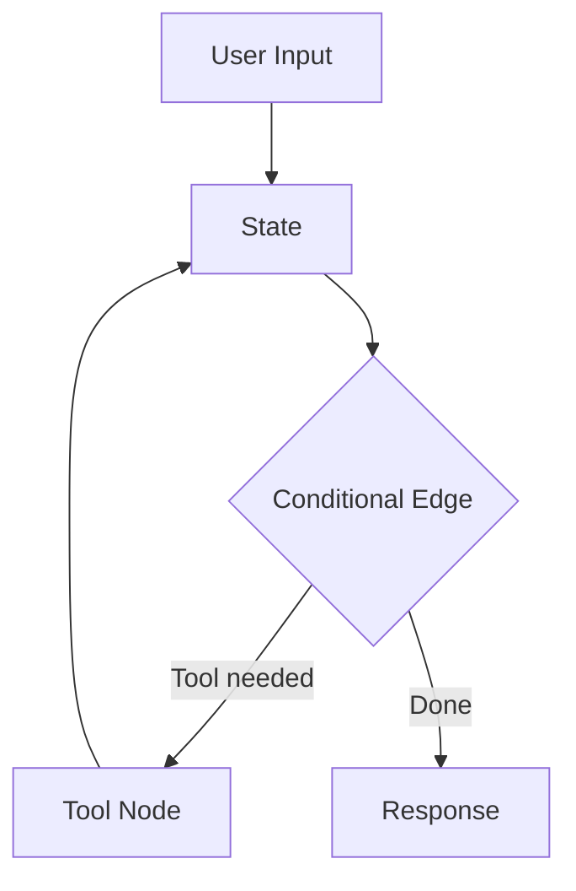
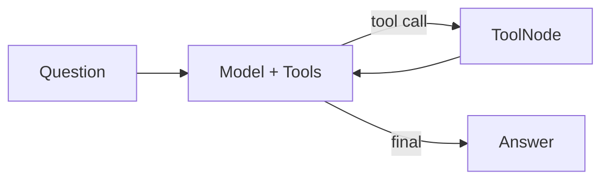

# Core Concepts — Agentic AI

Start here. These are the ideas you must understand before diving into code.

## Agent vs Agentic AI

| Term | Meaning |
|------|---------|
| **AI Agent** | A system that perceives, reasons, and takes actions (often using tools) toward a goal. |
| **Agentic AI** | Systems that plan, use tools, self-correct, remember, and collaborate across multiple steps. |

**Agent loop:** think → act (tool or subgraph) → observe → think again (until stop, limit, or human interrupt).

## LangGraph Basics

- **StateGraph**: Holds shared state between nodes.
- **Nodes**: Functions that read/update state.
- **Edges**: Connect nodes (fixed or conditional).
- **Reducers**: Merge parallel writes to the same field.
- **Checkpointer**: Saves state so you can resume (InMemory, SQLite, Postgres).
- **Subgraph**: One graph used inside another.
- **Command**: Explicit control (`goto`, `update`, `resume`).
- **Send**: Dynamic fan-out (map-reduce).

## ReAct & Tool Calling

Reason → Act (call tool) → Observe → Reason again.

## Agentic RAG

Naive RAG: retrieve once → generate.

Agentic RAG: grade → rewrite query → re-retrieve → (optional web fallback) → generate.

Production additions: hybrid search (dense + BM25 + RRF), reranking, parent-child chunking, citations, RAGAS evaluation.

## Human-in-the-Loop (HITL)

Pause the graph for human approval (or parallel interrupts). Resume with `Command(resume=...)`. Use a durable checkpointer (SQLite/Postgres) so it survives restarts.

## Multi-Agent Patterns

- **Supervisor**: One agent routes to specialists.
- **Handoffs**: Agents pass control to each other.
- **Orchestrator-worker**: Central planner + workers.
- **Map-reduce**: Fan-out with `Send`, then reduce.

## MCP (Model Context Protocol)

Standard way to expose tools to agents. Agent calls tools via an MCP client instead of hard-coded functions.

## Memory

| Type | Mechanism | Scope |
|------|-----------|-------|
| Short-term | Checkpointer + `thread_id` | One conversation |
| Long-term | Store + `user_id` | Across conversations |

## Evaluation (RAGAS)

| Metric | Measures | Needs reference? |
|--------|----------|------------------|
| Faithfulness | Claims supported by context | No |
| Response Relevancy | Answers the question | No |
| Context Precision | Relevant chunks ranked high | Optional |
| Context Recall | Reference claims found | Yes |
| Answer Correctness | Factual + semantic match | Yes |

See [reference/RAGAS-METRICS.md](reference/RAGAS-METRICS.md) for details.

---

**Next:** Read [INTERVIEW-QUESTIONS.md](INTERVIEW-QUESTIONS.md) then follow the stages in the main README.
