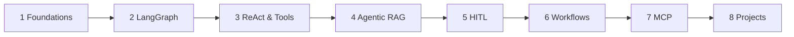

# Agentic AI Learning Path

**Beginner-friendly path for LangGraph, agents, Agentic RAG, HITL, and MCP.**

Start with concepts and interview questions. Then follow the stages.

---

## Start Here

1. **[CONCEPTS.md](CONCEPTS.md)** — Core ideas with diagrams (agent loop, LangGraph, ReAct, Agentic RAG, HITL, memory).
2. **[INTERVIEW-QUESTIONS.md](INTERVIEW-QUESTIONS.md)** — Practice these out loud.
3. **[PROJECTS.md](PROJECTS.md)** — Must-do projects in order.

Then work the stages below.

---

## Learning Path



| Stage | Folder | Focus |
|-------|--------|-------|
| 1 | [01-foundations-agents](01-foundations-agents) | Agent vs Agentic AI |
| 2 | [02-langgraph-basics](02-langgraph-basics) | State, nodes, edges, reducers, subgraphs |
| 3 | [03-react-and-tool-calling](03-react-and-tool-calling) | ReAct, tools, streaming, supervisor |
| 4 | [04-agentic-rag](04-agentic-rag) | Grade → rewrite → re-retrieve + production retrieval |
| 5 | [05-human-in-the-loop](05-human-in-the-loop) | Interrupts, parallel interrupts, checkpoints |
| 6 | [06-workflows-and-routing](06-workflows-and-routing) | Routing, subgraphs, map-reduce, multi-agent |
| 7 | [07-mcp-integration](07-mcp-integration) | MCP tools |
| 8 | [08-projects-and-interview](08-projects-and-interview) | Must-do projects + full interview bank |

Each stage folder has a README with concepts, interview questions, and source links.

---

## Setup

```bash
uv sync
cp .env.example .env   # add your API keys
uv run jupyter lab
```

Windows PowerShell:
```powershell
uv sync
copy .env.example .env
uv run jupyter lab
```

Never hardcode API keys. Use `.env`.

---

## Extra References (optional)

- [reference/RAGAS-METRICS.md](reference/RAGAS-METRICS.md) — Evaluation metrics
- [reference/TELUSKO-SESSION-MAP.md](reference/TELUSKO-SESSION-MAP.md) — Course session mapping
- [reference/5-STAR-MUST-DOS.md](reference/5-STAR-MUST-DOS.md) — Highest-ROI external projects
- [reference/PYTHON-FOR-GENAI-CONCEPTS.md](reference/PYTHON-FOR-GENAI-CONCEPTS.md) — Clean handbook extract

Related repos: [generative-ai-learning-path](https://github.com/yash9614/generative-ai-learning-path), [genai-learning-lab](https://github.com/yash9614/genai-learning-lab).

---

**Next step:** Open [CONCEPTS.md](CONCEPTS.md).
